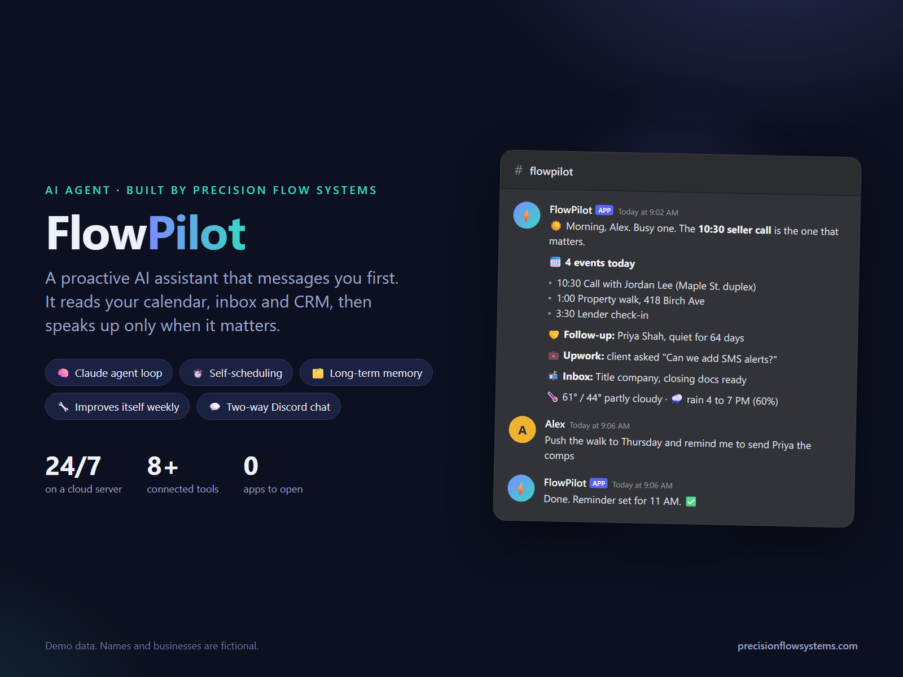
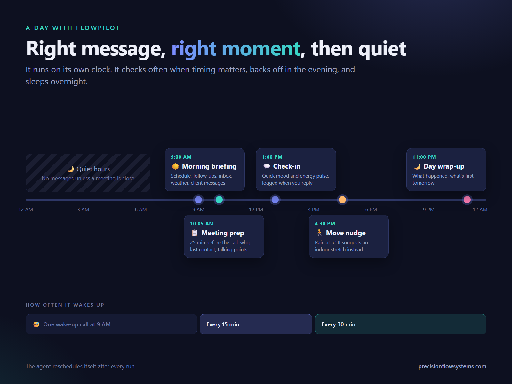
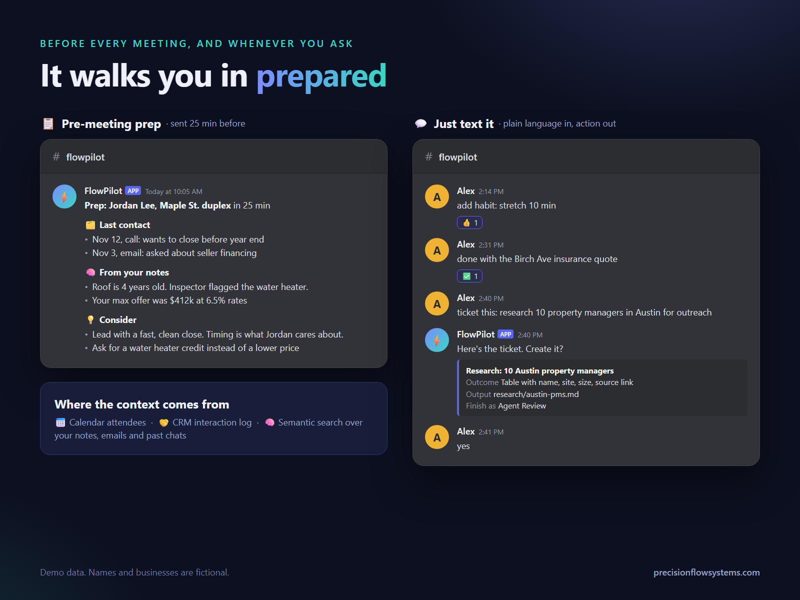
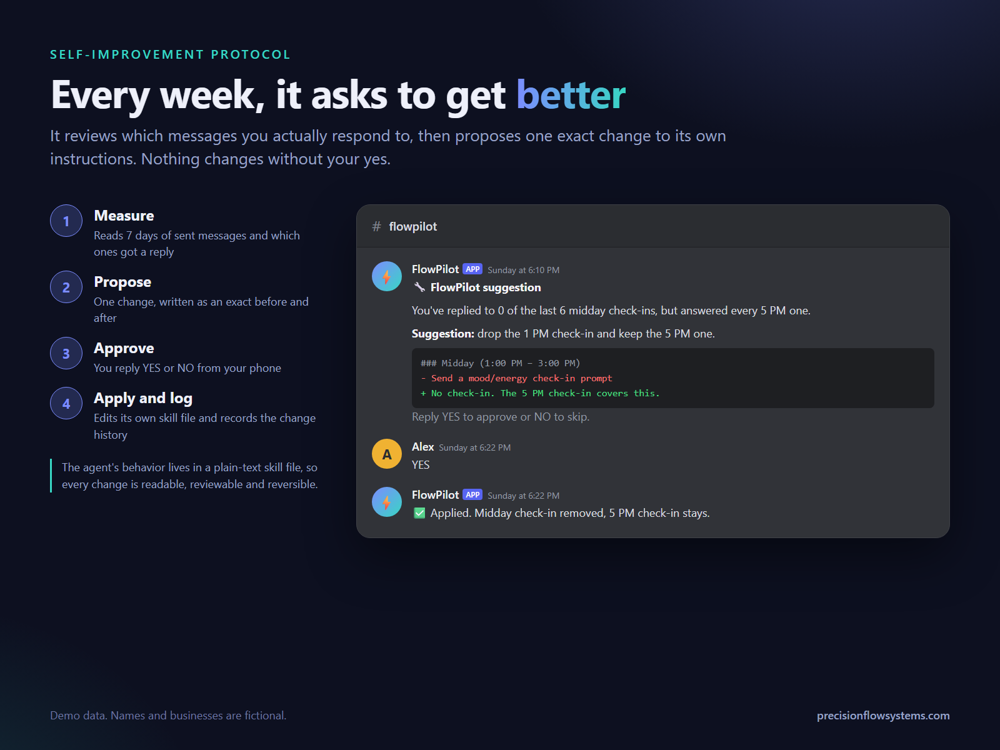
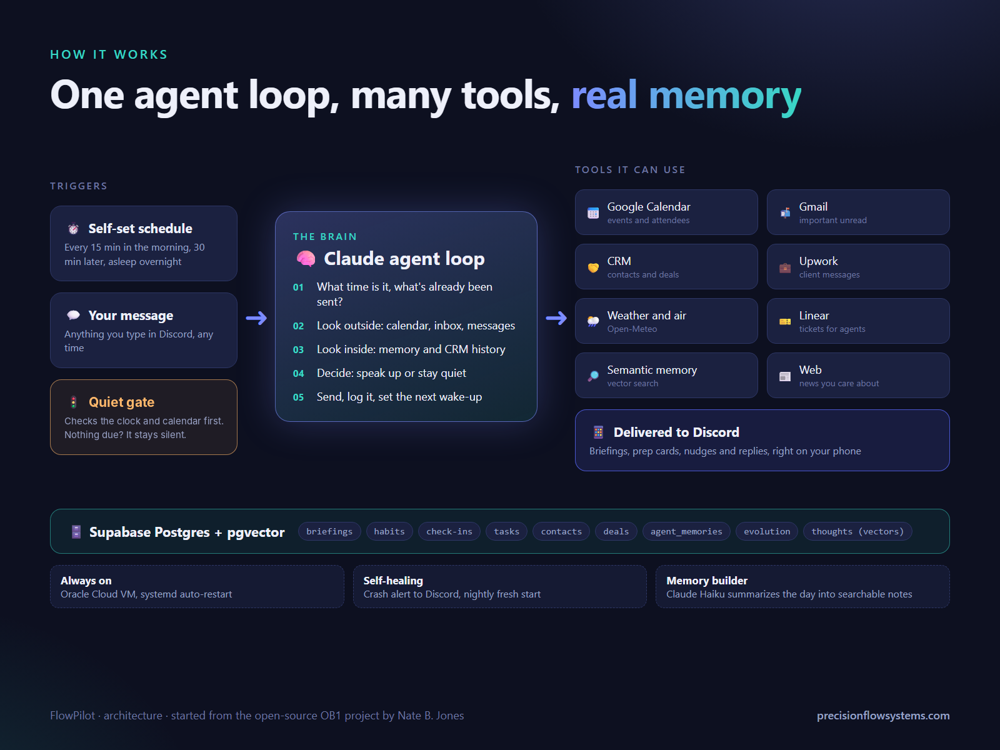

# FlowPilot

**A proactive AI assistant that messages you first.** FlowPilot runs Claude Code on a small always-on server. It wakes itself up on a smart schedule, reads your calendar, inbox and CRM, and sends a short Discord message only when something matters: a morning briefing, prep before a meeting, a nudge, or an evening wrap-up. Text it back in plain English to log habits, close tasks or queue work for other agents.



> Built by [Precision Flow Systems](https://precisionflowsystems.com). It started from the Life Engine recipe in Nate B. Jones's open-source [OB1](https://github.com/NateBJones-Projects/OB1) project. See [CREDITS.md](CREDITS.md).

## What it does

| | |
|---|---|
| ☀️ **Morning briefing** | Schedule, follow-ups, important dates, Upwork and email, pipeline, weather, news |
| 📋 **Meeting prep** | 15–45 minutes before a call: who, last contact, what your notes say, talking points |
| 💬 **Check-ins and nudges** | Mood and energy check-ins, a weather-aware movement nudge, an evening wrap-up |
| ✅ **Two-way chat** | "add habit: stretch", "done with the insurance quote", "what's next on the website?" |
| 🎫 **Agent tickets** | "ticket this: research 10 property managers" turns into a structured Linear ticket for a coding or research agent |
| 🔧 **Self-improvement** | Weekly, it reviews which messages you actually respond to and proposes one exact edit to its own skill. It only applies the edit if you say yes. |
| 🤫 **Quiet by default** | It logs everything it sends, never repeats a message, and stays silent overnight |







## How it works

FlowPilot is a **Claude Code skill**, not a custom app. Claude Code runs inside `tmux` with the official Discord channel plugin. The `/flowpilot` skill tells it what to do on each wake-up, and it uses Claude Code's own scheduler (`CronCreate`) to set its next wake-up. systemd keeps the whole thing alive.



```
systemd ─► start-flowpilot.py ─► tmux ─► claude --channels discord
                                              │
                    ┌─────────── /flowpilot ──┘   (reschedules itself after every run)
                    ▼
     calendar ─► "anything due?" ─► duplicate check ─► memory/CRM ─► Discord ─► log
                    │ no
                    ▼
                 stay quiet
```

> The images show the full production system. The nightly memory-ingest jobs on slides 2 and 6 aren't part of this repo. Long-term memory here comes from an Open Brain install (below).

## Repo layout

| Path | What |
|---|---|
| `skills/flowpilot/SKILL.md` | The assistant: time windows, loop, message formats, rules |
| `skills/agent-ticket/SKILL.md` | Writes standardized Linear tickets for other agents |
| `scripts/start-flowpilot.py` | Starts Claude Code in tmux, sends `/flowpilot`, and exits if the session dies |
| `scripts/supabase.sh` | `sb_query`, `sb_insert`, `sb_update`, `sb_upsert`, `sb_delete`, `sb_rpc`, `sb_sql` |
| `scripts/discord-notify.sh` | Direct bot message for crash alerts, which works even when Claude is down |
| `systemd/` | The service, a crash-alert unit, and a daily restart timer |
| `sql/schema.sql` | Tables, indexes and RLS |
| `install.sh` | Installs the skills and systemd units |

## Setup

**You need:** a Linux server (an Oracle Cloud free-tier VM works), a Claude subscription with Claude Code, a Supabase project, and a Discord server with a bot.

1. **Database.** Run `sql/schema.sql` in the Supabase SQL Editor. Then add your config rows to `flowpilot_state` (see the example at the bottom of the file).
2. **Server.**
   ```bash
   sudo apt install -y tmux postgresql-client python3
   curl -fsSL https://claude.ai/install.sh | bash   # then run `claude` once and log in
   git clone https://github.com/Amy-Mollerup/flowpilot.git ~/flowpilot
   cd ~/flowpilot && cp .env.example .env && nano .env
   ```
3. **Discord.** Install the Discord channel plugin in Claude Code and pair your account (follow the plugin's instructions). Put the channel you want alerts in into `DISCORD_ALERT_CHANNEL_ID`.
4. **Connectors.** In Claude Code, connect Google Calendar (required). Gmail, Upwork and Linear are optional. FlowPilot skips any that aren't connected.
5. **Install and start.**
   ```bash
   ./install.sh
   sudo systemctl start flowpilot flowpilot-daily-restart.timer
   tmux attach -t flowpilot      # watch it; detach with Ctrl+B then D
   ```

### Optional add-ons
- **CRM:** install OB1's [professional-crm extension](https://github.com/NateBJones-Projects/OB1/tree/main/extensions/professional-crm) for contacts, interactions and pipeline.
- **Long-term memory:** set up [Open Brain](https://github.com/NateBJones-Projects/OB1) and connect its MCP server to Claude Code. FlowPilot uses it for meeting context and "remember this".

## ⚠️ Security

- FlowPilot runs Claude Code with `--dangerously-skip-permissions` so it can work unattended. **Run it on a dedicated server or VM** that holds nothing else you care about. Never run it on your laptop.
- Only your paired Discord account can talk to it. The skill treats every chat message, and everything it reads (emails, calendar invites, Upwork messages, web pages, memory), as untrusted data: it won't run commands, change config, reveal keys or contact anyone because that content asked.
- The Supabase service role key bypasses row-level security. Keep it in `.env` on the server, and never put it in a client app or a phone automation.

## License

FSL-1.1-MIT, the same as the project it came from. FlowPilot's own changes are Copyright 2026 Precision Flow Systems LLC. See [LICENSE.md](LICENSE.md) and [CREDITS.md](CREDITS.md). You can use, modify and share it, and use it to deliver services, but you can't offer it as a competing commercial product. Each version becomes MIT-licensed two years after release.

## Hire us

Want FlowPilot set up for you, connected to Slack, SMS or your own CRM, or tuned for your team? [precisionflowsystems.com](https://precisionflowsystems.com)
